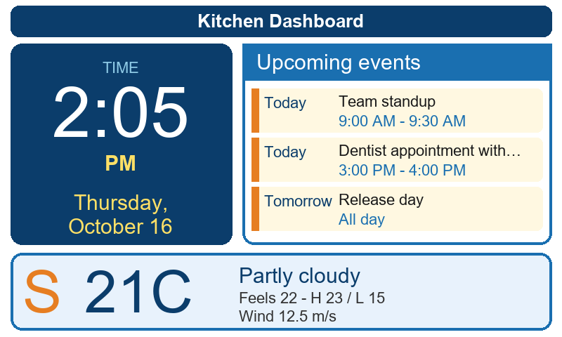

# InkyPi-inkypi_multiview

*Dashboard Clock* is a plugin for [InkyPi](https://github.com/fatihak/InkyPi) that displays a dashboard with a digital clock on the left, upcoming events on the right, and current weather on the bottom.

## Screenshot



> Screenshot is a mock preview rendered at 800x480. Actual output follows your InkyPi display resolution, orientation, timezone and style settings.

## Installation

Install the plugin using the InkyPi CLI, providing the plugin ID and GitHub repository URL:

```bash
inkypi install inkypi_multiview https://github.com/SunkCircle88900/InkyPi-inkypi_multiview
```

Then restart InkyPi and add "Dashboard Clock" to a playlist.

## Configuration

In the plugin settings:

- **Dashboard title (optional)** — small header line, leave blank to hide.
- **Latitude / Longitude** — required, used for weather. Example: New York `40.7128 / -74.0060`. Click **Select on map** to drop a pin: click anywhere or drag the marker, then **Save pin**.
- **Units** — `metric` (°C), `imperial` (°F), `standard` (K).
- **Calendars** — one or more **public** iCal URLs (`.ics`). A broken/private feed is skipped with an on-screen warning instead of breaking the whole dashboard (clock + weather keep working).
  - Google Calendar: Settings → Integrate calendar → Public address in iCal format.
  - Apple Calendar: open Calendar → share the calendar → turn on **Public Calendar** → use the **Public address** link (`https://pXX-caldav.icloud.com/published/...`). Your private iCloud CalDAV login URL will **not** work (needs your Apple ID) — the plugin will show a warning for it.
  - `webcal://` URLs are accepted and converted to `https://` automatically.
- **Max events (1-10)** — default 5.
- **Max words per event title (1-10)** — default 5. Long titles are cut with … (max ~32 chars) so they can't push other columns out of bounds.
- **Look ahead days (1-30)** — default 14.
- **Show seconds** — adds `:SS` to the digital clock.

Clock time/date follow the InkyPi device **timezone** and **time_format (12h/24h)** settings.

Style (text color, background, margins, frame) is controlled by the standard InkyPi style settings.

## API Keys

None. Weather uses [Open-Meteo Forecast API](https://open-meteo.com/en/docs):

- Docs: https://open-meteo.com/en/docs
- No API key required.
- Free for non-commercial use, rate limits are generous (no key, CORS-enabled). If you hit errors, check InkyPi logs — the plugin raises `RuntimeError: Weather request failed...`.

Calendars use plain HTTPS GET of public `.ics` feeds (libraries `icalendar` + `recurring_ical_events`, already included in InkyPi).

## Layout

- **Left:** large digital clock + full date (e.g. `Thursday, October 16`).
- **Right:** upcoming events list with `Today / Tomorrow / Mon 10/20` labels and start–end times, `All day` for all-day events.
- **Bottom:** current temperature, condition (WMO code → text + symbol), feels-like, today's high/low, wind speed/direction arrow.

Portrait displays stack clock on top automatically via CSS media query.

## Development status

Work in progress — actively maintained. Tested against InkyPi `plugin-info.json` + `BasePlugin.render_image` HTML/CSS pipeline.

Reported to work on 800x480 and vertical orientations; other resolutions use the same responsive flex layout.

## License

This project is licensed under the MIT License — see [LICENSE](LICENSE) for details.
